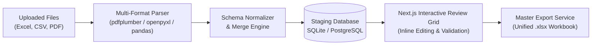

# 📑 Data Consolidator

**Automated Multi-Format Document Ingestion, Column Normalization, Interactive Review, and Master Spreadsheet Consolidation Engine**

[](https://fastapi.tiangolo.com/)
[](https://nextjs.org/)
[](https://react.dev/)
[](https://pandas.pydata.org/)
[](https://pymupdf.readthedocs.io/)
[](https://tailwindcss.com/)

---

## 📌 Executive Summary

Organizations frequently receive critical tabular business data scattered across incompatible formats: legacy Excel workbooks (`.xls`, `.xlsx`), comma-separated files (`.csv`), and locked PDF documents. Consolidating these records manually takes hours and introduces human copy-paste errors.

**Data Consolidator** is a modern full-stack data pipeline and web application that automates extraction, column alignment, interactive data cleansing, and master export. Users drag and drop batches of heterogenous files; the backend parses tables, intelligently reconciles differing header schemas, presents an editable review grid, and exports a unified master Excel file.

---

## 🔄 Data Pipeline Workflow



---

## ✨ Key Capabilities

- **Intelligent Multi-Format Ingestion**:
  - **Excel (`.xlsx`, `.xls`)**: Multi-sheet extraction via `openpyxl` and `xlrd`.
  - **CSV**: Encoding auto-detection (`chardet`) with dynamic delimiter parsing.
  - **PDF Documents**: High-accuracy table boundary detection using `pdfplumber` and `PyMuPDF`.
- **Heuristic Schema Alignment**: Merges datasets with differing column names (e.g. mapping `"Client Name"`, `"Customer"`, and `"Name"` to a canonical schema).
- **Interactive Review Interface**: Web-based editable grid allowing operators to audit, filter, correct typos, and delete erroneous rows before finalizing the export.
- **Enterprise-Grade Backend**: FastAPI service structured with Pydantic validation schemas, SQLAlchemy ORM, and JWT authentication (`pyjwt`, `bcrypt`).

---

## 📂 Repository Layout

```text
data-consolidator/
├── backend/                    # Python FastAPI Backend
│   ├── app/
│   │   ├── api/                # Endpoints (auth, datasets, uploads, exports)
│   │   ├── core/               # Configuration, security, database connection
│   │   ├── models/             # SQLAlchemy dataset and row models
│   │   ├── schemas/            # Pydantic request/response schemas
│   │   ├── services/           # Merge engine, file processor, export service
│   │   └── main.py             # FastAPI entrypoint
│   ├── tests/                  # PyTest backend test suite
│   ├── verify_system.py        # System smoke test script
│   └── requirements.txt
├── frontend/                   # Next.js 16 Web Dashboard
│   ├── src/
│   │   ├── app/                # App router views and consolidation grid
│   │   ├── components/         # Upload dropzone, data review table
│   │   └── utils/              # API fetch client
│   ├── package.json
│   └── tsconfig.json
├── run.bat                     # Windows one-click local launcher
└── README.md
```

---

## 🚀 Quickstart Guide

### Option 1: Quickstart (Windows)
Double-click `run.bat` or run:
```cmd
run.bat
```

### Option 2: Manual Setup

#### 1. Backend Service
```bash
cd backend
python -m venv .venv
source .venv/bin/activate # Windows: .venv\Scripts\activate
pip install -r requirements.txt
uvicorn app.main:app --reload --port 8000
```
API Documentation: [http://localhost:8000/docs](http://localhost:8000/docs)

#### 2. Frontend Interface
```bash
cd ../frontend
npm install
npm run dev
```
Open [http://localhost:3000](http://localhost:3000) in your browser.

---

## 👤 Author
**Ansh Arora**  
- GitHub: [@anshere0](https://github.com/anshere0)  
- LinkedIn: [Ansh Arora](https://www.linkedin.com/in/ansh-arora0/)
